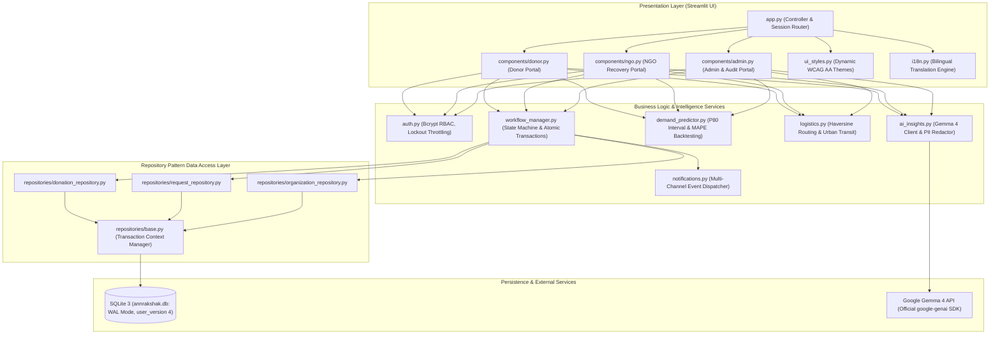
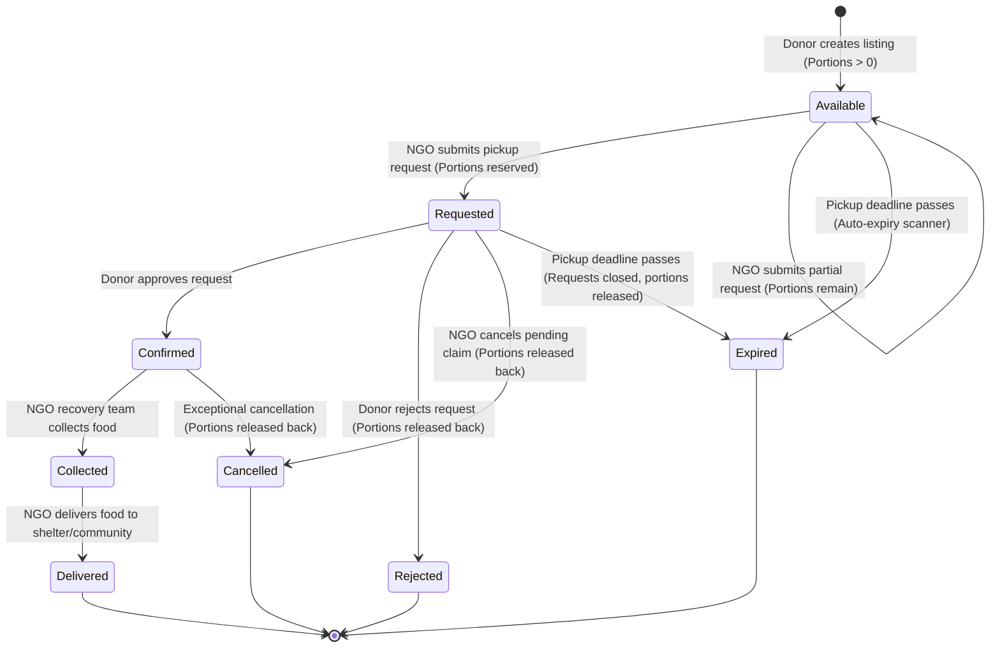
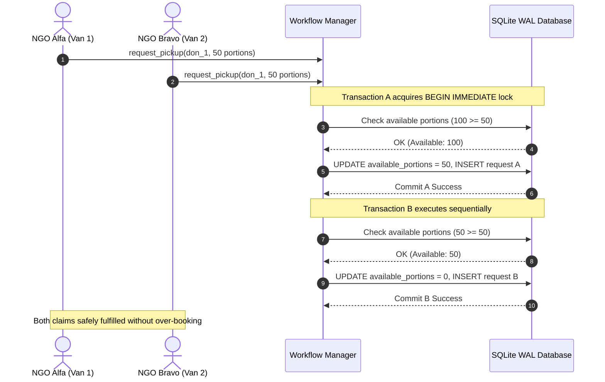

# 🏛️ AnnRakshak AI — Enterprise Architecture & System Design Document

> **System:** AnnRakshak AI (अन्न बचाओ, बर्बादी घटाओ)  
> **Deployment Target:** Prayagraj Municipal Surplus Food Logistics Pilot  
> **Core Stack:** Python 3.11, Streamlit, SQLite 3 (WAL mode, `user_version = 4`), Google GenAI (Gemma 4), Playwright  

---

## 1. System Overview & Layered Architecture

AnnRakshak AI is engineered with strict separation of concerns, decoupling presentation controllers from transactional business logic and relational database persistence via the Repository Pattern.

---

## 2. Monotonic State Transition Machine & Invariants

Donation state is deterministically derived from portion balances, pickup deadlines, and active request states (`derive_donation_status()`). Once a milestone is reached, status cannot move backward.

### Invariant Rules:
1. **Portion Conservation Invariant:**
   $$\text{available\_portions} + \sum(\text{portions of active requests}) + \text{delivered\_portions} = \text{quantity\_portions}$$
   where active requests are those in `Requested`, `Confirmed`, or `Collected` state.
2. **Atomic Restoration:** On request rejection, cancellation, or expiry, reserved portions return to `available_portions` if the pickup deadline has not elapsed. If the deadline has passed, the donation transitions to `Expired` and food cannot be claimed.
3. **No Availability with Zero Balance:** A donation is never marked `Available` if `available_portions == 0`.
4. **State Machine Verification:** Validated by `test_p0_b_backend.py` using a 500-step randomized state machine test that asserts `invariant_check(donation_id)` after every transition.

---

## 3. High-Concurrency Transaction Isolation

To prevent double-booking when multiple NGOs claim overlapping portions simultaneously, the database repository enforces SQLite `BEGIN IMMEDIATE` transactions:

---

## 4. Threat Model & Security Posture

A comprehensive threat analysis is documented in [`THREAT_MODEL.md`](THREAT_MODEL.md). Key defenses include:
- **Mandatory `acting_user` Authorization:** Checked at the service layer on all 7 workflow functions. Missing or unverified sessions fail closed.
- **Bcrypt Password Storage:** Eliminates plaintext or hardcoded credentials.
- **Constant-Time Timing Defense:** Nonexistent accounts trigger a dummy bcrypt comparison to thwart username enumeration.
- **Login Throttling:** 5 failed attempts in 5 minutes locks the account for 5 minutes.
- **PII Redaction:** Donor telephone numbers are masked by default (`+XX-XXXXX-XX87`) and omitted from CSV exports and AI prompts.

---

## 5. Known Operational Limitations

1. **Single-Host SQLite Architecture:** WAL mode enables concurrent readers with serialized writers on a single node. It does not provide multi-node clustering or cross-region failover.
2. **No Automatic High Availability:** If the server hardware fails, manual restart or container recreation is required.
3. **Streamlit Session State Volatility:** Streamlit holds user session states in server memory. Client browser reloads reset transient form fields.
4. **AI Safety Classifiers:** Gemma 4 uses regex-based PII scrubbing and prompt sanitization; it does not currently employ automated adversarial prompt injection classifiers.
